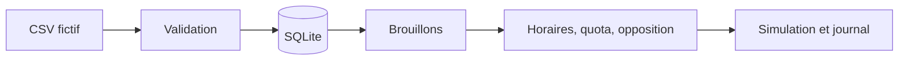

# Serenity Prospection Lab

**Aïmane Ramzi · Python, SQLite et automatisation**

Une édition publique **hors ligne** du travail d'orchestration réalisé pour
SerenityWeb : importer des contacts, préparer des messages, appliquer des limites
et suivre des états. Ce dépôt ne contient pas de fichier de prospects réel et
**ne peut pas envoyer d'email**.

## Pourquoi ce projet

Un traitement automatisé doit pouvoir être expliqué : quel contact a été importé,
quel brouillon a été préparé, pourquoi une action a été bloquée et ce qui a été
simulé. SQLite fournit une trace consultable sans multiplier les fichiers dispersés.

## Démonstration

Prérequis : Python 3.10 ou plus. Bibliothèque standard uniquement.

```sh
python3 demo.py
python3 -m unittest discover -s tests -v
```

La démonstration utilise une base en mémoire, des entreprises fictives et une
date fixe pour être reproductible. Les adresses se terminent obligatoirement
par `.invalid`. Il n'y a pas d'appel réseau, pas de clé API ni de transport SMTP.

## Fonctionnalités de cette édition

- Import CSV validé et dédoublonné, sans écraser une opposition existante.
- Brouillons construits à partir des données importées.
- Limite quotidienne, horaires de simulation et espacement entre deux actions.
- Limitation d'un même domaine sur sept jours.
- Opposition et réponse enregistrées manuellement : les simulations suivantes sont bloquées.
- État `simulated` explicite, journal SQLite et transaction pour éviter les doublons.



## Différence avec le projet privé

Le projet privé comporte une intégration Resend et des relances. Elles ne sont
pas distribuées ici. La version publique est une adaptation pédagogique, préparée
avec assistance IA, pas une copie complète du service de prospection. Elle
n'effectue ni collecte d'adresses, ni envoi, ni suivi d'ouverture.

Dans le projet privé, le raccordement automatique des réponses et oppositions
doit être vérifié/finalisé avant de présenter le système comme autonome. Le
laboratoire montre seulement des transitions manuelles testables ; il n'atteste
pas de la conformité d'une campagne ni de l'autorisation de contacter quelqu'un.

Voir [les décisions et limites](docs/design.md). Aucune licence de réutilisation
n'est accordée à ce stade. Les outils tiers conservent leurs licences.
